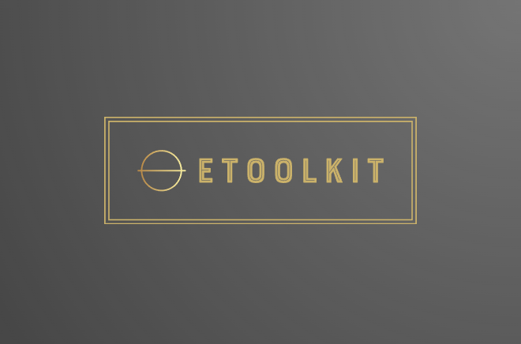

# EToolkit



[](https://en.cppreference.com/w/cpp/11)
[](https://learn.microsoft.com/en-us/windows/win32/apiindex/api-index-portal/)
[](https://cmake.org/cmake/help/v3.16/)
[](https://choosealicense.com/licenses/bsl-1.0/)
[](https://github.com/evandroluizvieira/EToolkit/actions/workflows/ci.yml)
[](https://evandroluizvieira.github.io/EToolkit/)
[](https://github.com/evandroluizvieira/EToolkit/releases)

## Overview

EToolkit is a C++ library that serves as a Win32 API wrapper.

This first `main` commit establishes the project baseline (governance, automation, quality, and
release configuration). Implementation modules are added in subsequent development branches.

The library is open source and licensed under the BSL 1.0 license.

## Installation
To get started, clone the repository:
```bash
git clone https://github.com/evandroluizvieira/EToolkit.git
```

## Build and tests

```text
cmake -S . -B build -G Ninja
cmake --build build
ctest --test-dir build --output-on-failure
```

In this initial setup commit, the build validates repository configuration and workflow wiring.

## Continuous integration and releases

GitHub Actions validates Pull Requests targeting the project's primary branch, defined in
`main`, and pushes to that branch.

The authoritative development version is stored in `VERSION`.
Versioned distribution is separate: an approved SemVer tag triggers packaging and publication to
GitHub Releases.

## Project governance

- [DEVELOPMENT.md](DEVELOPMENT.md)
- [CONTRIBUTING.md](CONTRIBUTING.md)
- [ARCHITECTURE.md](ARCHITECTURE.md)
- [RELEASE.md](RELEASE.md)
- [DEPLOYMENT.md](DEPLOYMENT.md)
- [PROJECT_STATUS.md](PROJECT_STATUS.md)
- [REQUIREMENTS.md](REQUIREMENTS.md)
- [ROADMAP.md](ROADMAP.md)
- [IMPLEMENTATION_PLAN.md](IMPLEMENTATION_PLAN.md)
- [TEST_PLAN.md](TEST_PLAN.md)
- [OPERATIONS.md](OPERATIONS.md)
- [RISK_REGISTER.md](RISK_REGISTER.md)

## Usage

Usage examples are documented as part of the regular development flow after the baseline branch is
published.
